# Original sample gallery

All 20 samples were built on Windows, installed into the real Vega virtual device and checked for visible UI and remote interaction. These images are actual emulator captures, not design mockups. They contain synthetic sample data.

Choose a template in New project, or open its standalone source under `examples/`. Set a unique package ID before publishing your own app. Install pinned dependencies through Build package. Private state and signing identities are created locally and are not included.

| Sample | Purpose | Emulator view |
| --- | --- | --- |
| [Focus Harbor TV](../examples/focus-harbor/) | Work and break timers with persistent sessions, pause/resume and a completed-session count. | 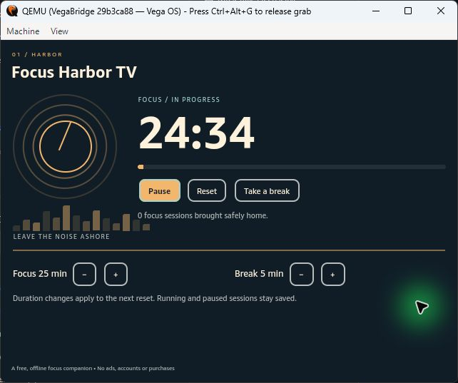 |
| [Room Rounds](../examples/room-rounds/) | Rotate household tasks across people and track completed rounds. | 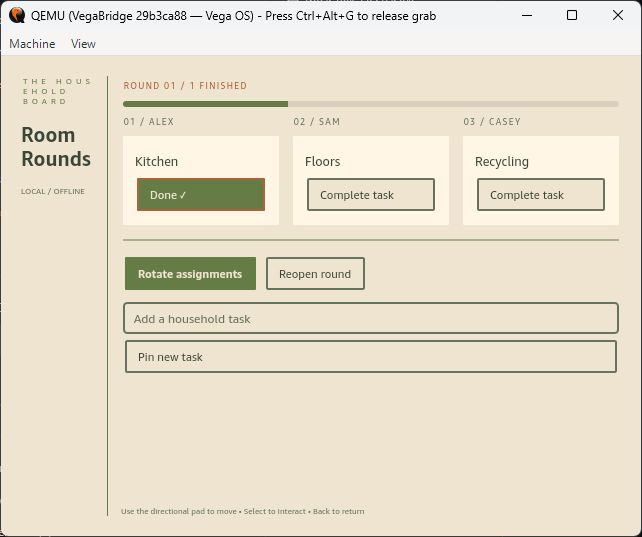 |
| [Measure Mosaic](../examples/measure-mosaic/) | Convert distances and temperatures with a remote-controlled value pad. | 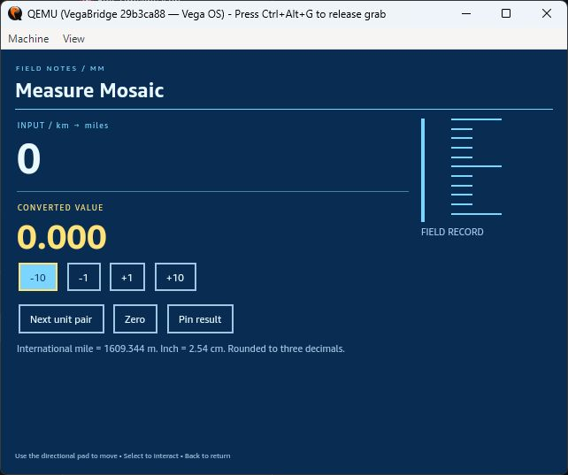 |
| [Signal Bench](../examples/signal-bench/) | Inspect screen metrics and monitor real TV remote input events. | 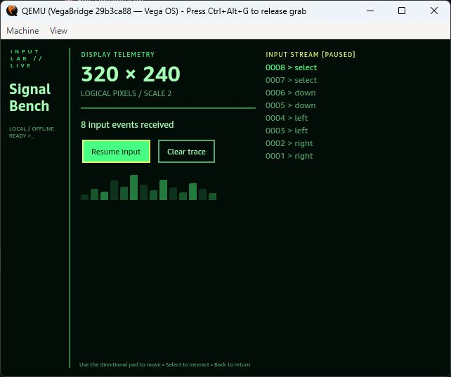 |
| [Pantry Orbit](../examples/pantry-orbit/) | Build a weekly meal rotation from an editable pantry shortlist. | 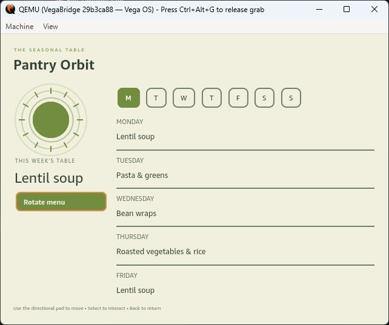 |
| [Agenda Arc](../examples/agenda-arc/) | Plan a week using editable daily focus cards. | 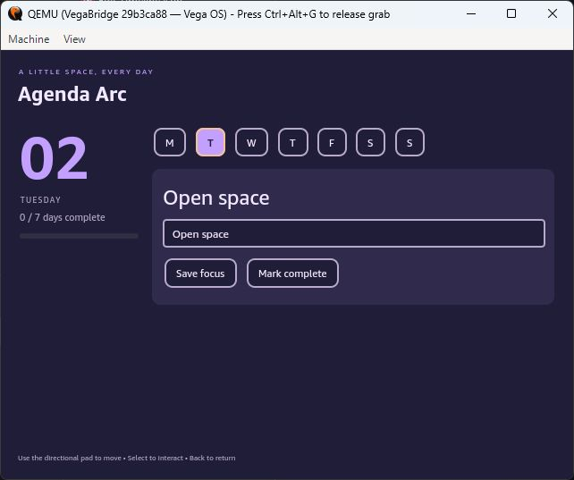 |
| [Split Ledger](../examples/split-ledger/) | Calculate a shared bill with adjustable tip and group size. | 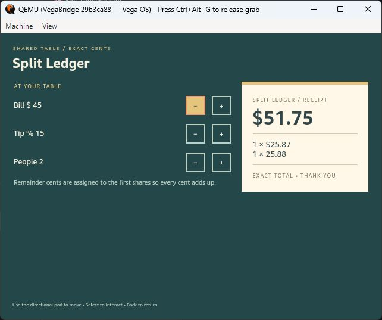 |
| [Quiet Intervals](../examples/quiet-intervals/) | An adjustable visual pacing loop with a pause control. | 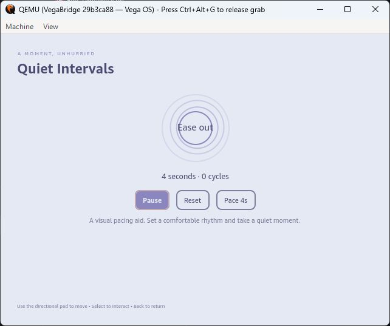 |
| [Palette Dock](../examples/palette-dock/) | Explore color pairs and calculate their actual WCAG contrast ratio. | 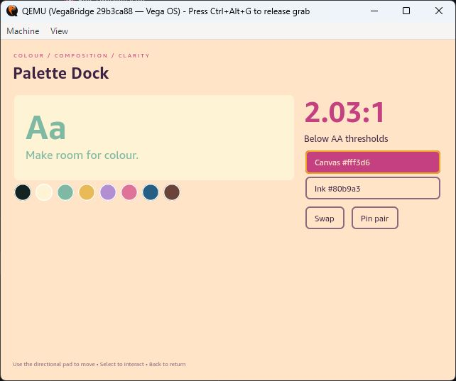 |
| [Story Sparks](../examples/story-sparks/) | Generate and save original writing prompts from combinatorial story ingredients. | 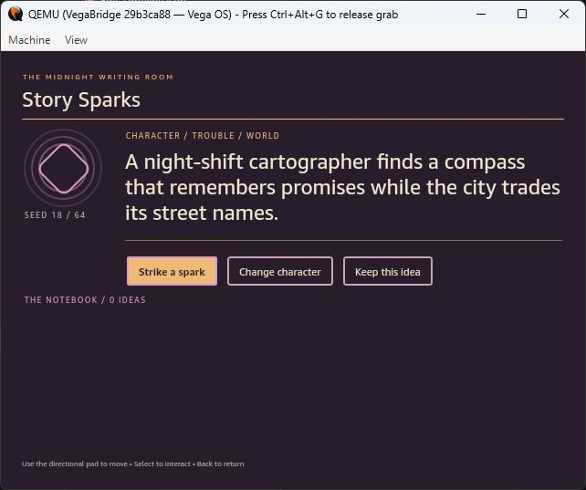 |
| [Decision Dock](../examples/decision-dock/) | Create options, collect local votes and see a tie-aware result. | 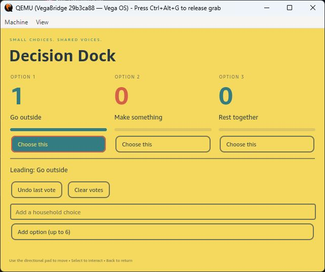 |
| [Packing Lantern](../examples/packing-lantern/) | Create a reusable packing checklist and track packed items. | 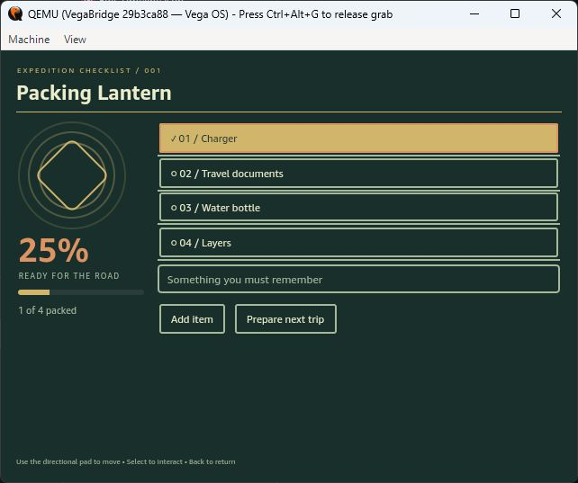 |
| [Tempo Tiles](../examples/tempo-tiles/) | A visual metronome with tempo and beat-group controls. | 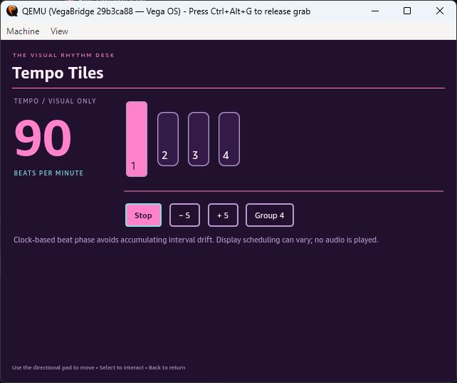 |
| [Session Canvas](../examples/session-canvas/) | Write cue cards and present them as a full-screen TV sequence. | 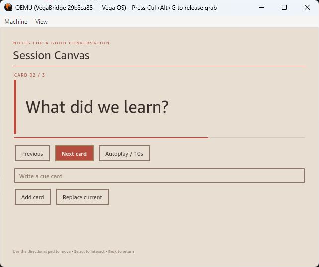 |
| [Word Garden](../examples/word-garden/) | Arrange letter tiles to uncover locally generated word clues. | 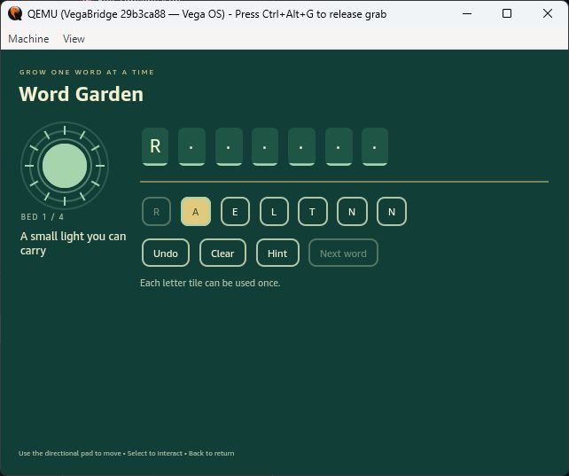 |
| [Ember Courier](../examples/ember-courier/) | Deliver sparks to four corner beacons while managing heat and cooling tiles. | 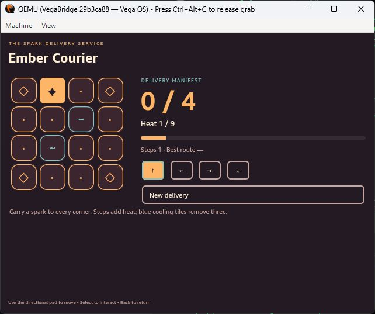 |
| [Orbit Orchard](../examples/orbit-orchard/) | Plant drifting fruit in columns; predict the next wind before harvesting groups. | 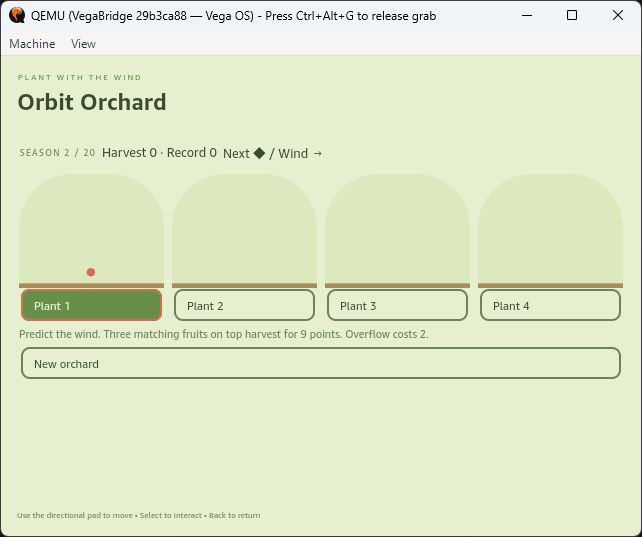 |
| [Beacon Weave](../examples/beacon-weave/) | Weave a target light pattern using diagonal toggle stitches. | 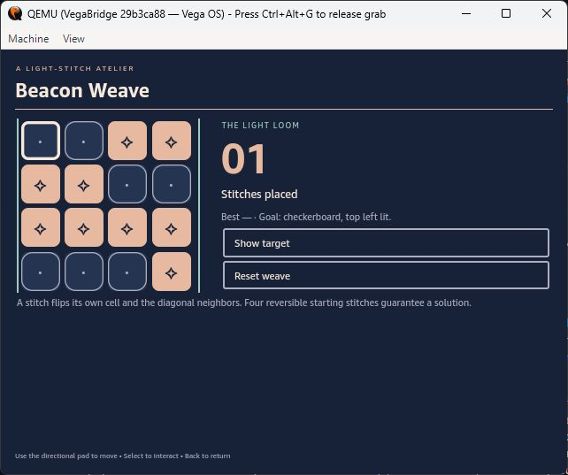 |
| [Echo Atlas](../examples/echo-atlas/) | Recall a growing glyph route while its map rotates between rounds. | 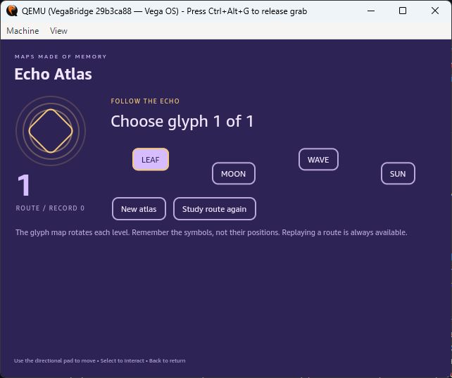 |
| [Tide Parcel](../examples/tide-parcel/) | Navigate three changing tide lanes, collect parcels and save anchors for storms. | 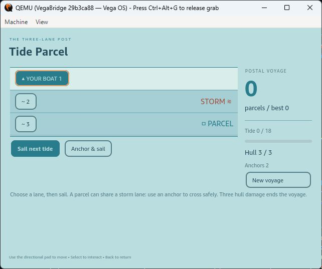 |

## Game progression checked

Ember Courier completed a 17-step, four-beacon route at heat 5/9. Orbit Orchard completed its 20-turn season with 54 points. Beacon Weave reached the target pattern in six stitches. Echo Atlas completed two memory routes, handled a wrong glyph, and replayed a route. Tide Parcel completed 18 tides with 13 parcels, full hull and one anchor remaining. These are functional developer checks, not a claim of exhaustive gameplay QA.

## Scope

The sample apps work offline and use original code-drawn illustrations. Common mechanics may resemble other software; no existing game characters, branding or copied artwork are included. The gallery targets TV remote navigation. The emulator’s system keyboard can differ from a physical device; PC text injection was also tested. Media playback, IAP, DRM and hardware peripherals are separate qualification work.
