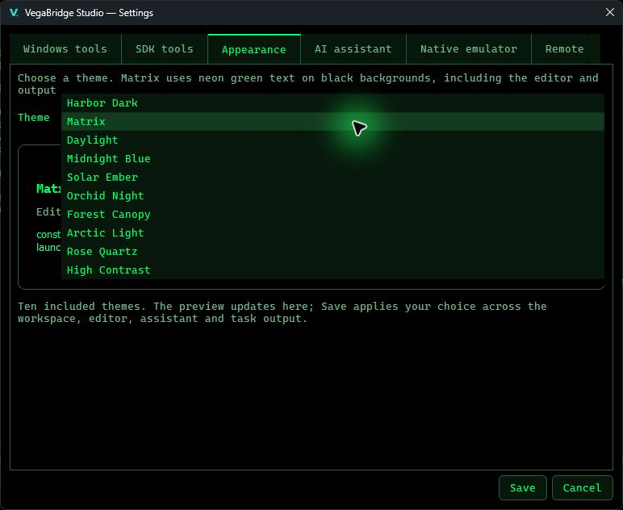
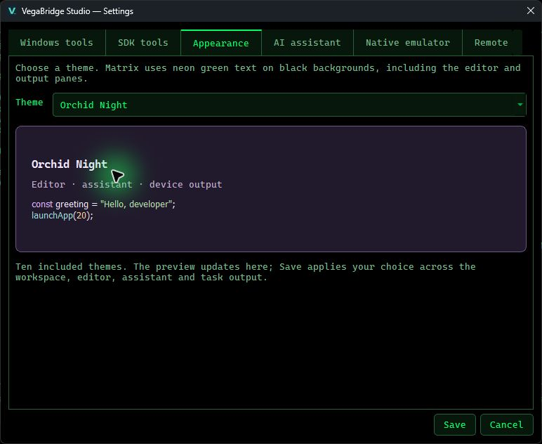

# Theme selection

Choose **Settings → Appearance** to preview any of the ten built-in themes. Save applies the palette to the complete workspace and the code editor; it persists across restarts. The assistant can also select any theme by name. Themes change Studio, not the app you are developing.

| Theme | Background | Text | Accent |
| --- | --- | --- | --- |
| Harbor Dark | `#101822` | `#dae4f0` | `#50d6b7` |
| Matrix | `#000000` | `#00ff66` | `#00ff66` |
| Daylight | `#ffffff` | `#162435` | `#006b59` |
| Midnight Blue | `#0a1022` | `#e3eaff` | `#8bb2ff` |
| Solar Ember | `#211814` | `#f6e9d8` | `#f0ab69` |
| Orchid Night | `#211a2c` | `#f4e7ff` | `#d8a4fa` |
| Forest Canopy | `#10211c` | `#e5f4dd` | `#a0d38d` |
| Arctic Light | `#f1f7fb` | `#193448` | `#166789` |
| Rose Quartz | `#fff6f5` | `#4b2f3d` | `#a03b68` |
| High Contrast | `#000000` | `#ffffff` | `#ffff00` |

Matrix uses neon green text on black with a coding font. High Contrast uses black, white and yellow. Daylight, Arctic Light and Rose Quartz provide light workspaces; the remaining palettes provide distinct dark workspaces. All palettes include separate source syntax colors, line highlighting, selection, disabled-control and task-output styles.

Automated checks switch through all ten palettes, preserve editor content and verify text/background and primary-button contrast. Native UI checks cover the theme picker and preview.

